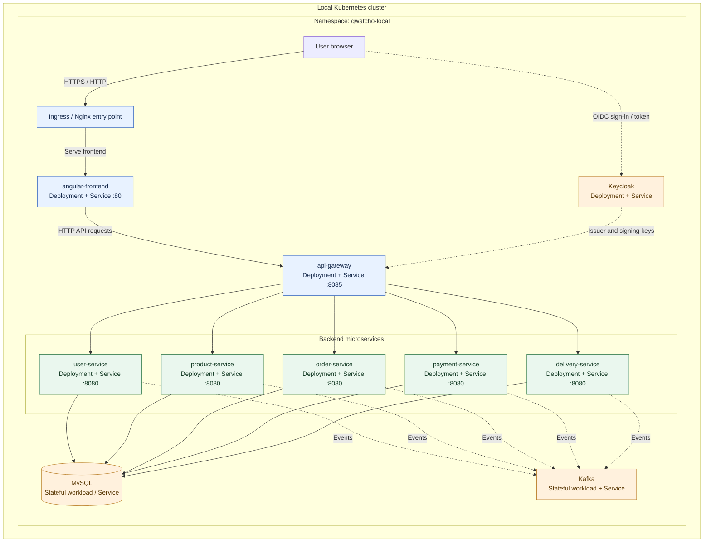

# Angular Frontend and Microservices Architecture

## Overview

The GWatcho Webshop application is deployed on the local Kubernetes cluster in namespace `gwatcho-local`. The Angular frontend is exposed through the Kubernetes ingress/reverse-proxy entry point and communicates with backend services through the API Gateway. The application runtime components shown below are Kubernetes workloads or Kubernetes Services.

This page documents the Kubernetes deployment view only. It does not describe the earlier Docker Compose runtime or a mixed Docker/Kubernetes topology. External dependencies, persistent storage, and host-level networking are represented only where they are part of the Kubernetes deployment configuration.

## Kubernetes architecture diagram

The diagram shows the Kubernetes namespace, application workloads, service-to-service traffic, authentication, and asynchronous messaging. The frontend is reached by the user's browser through the cluster entry point. Browser API traffic is sent to the API Gateway using a browser-reachable URL; Kubernetes DNS names are used only for in-cluster communication.



> **Deployment accuracy:** This diagram is a Kubernetes logical architecture view. It does not assert the exact replica count, storage class, PVC layout, ingress controller implementation, or database topology. Confirm those details from the live manifests and cluster resources before treating them as deployment facts. If a dependency is not currently deployed in `gwatcho-local`, it should be added to the diagram only after its Kubernetes workload and Service are in place.

### Request and authentication flow

1. The browser opens the frontend through the Kubernetes ingress/reverse-proxy entry point.
2. The entry point routes the frontend request to the `angular-frontend` Service on port 80.
3. Angular uses a browser-reachable API URL to call the API Gateway. Do not place Kubernetes-only DNS names in browser configuration.
4. The user signs in through Keycloak using the configured OIDC client and realm.
5. Angular sends the access token with protected API requests. The API Gateway validates the JWT against the configured issuer and signing-key metadata.
6. The API Gateway routes requests to the appropriate backend Service: `user-service`, `product-service`, `order-service`, `payment-service`, or `delivery-service`.
7. Backend services access their configured database endpoint and exchange asynchronous events through Kafka where their producer/consumer configuration requires it.

## Kubernetes networking and service discovery

Kubernetes Services provide stable in-cluster endpoints for the frontend, API Gateway, backend services, and infrastructure workloads. Within the namespace, workloads should use the Kubernetes Service DNS name and the Service port rather than a pod IP.

Verify the following for each connection:

- The target Deployment/StatefulSet and Service exist in namespace `gwatcho-local`.
- Service selectors match the labels on the intended Pods.
- Service `port` and `targetPort` match the container's listening port.
- NetworkPolicies, if enabled, permit the required traffic.
- The Keycloak JWT `iss` value exactly matches the issuer expected by the API Gateway. A mismatch causes JWT validation failures.
- Kafka's advertised listeners resolve to addresses reachable by Kubernetes clients. A reachable bootstrap port alone is not sufficient.
- Database connection URLs, schema names, and credentials match the service configuration or the Kubernetes/Vault-injected Secrets.
- Persistent workloads use the intended PersistentVolumeClaims and StorageClass.

For troubleshooting, inspect the live cluster rather than assuming that a host name or port from Docker Compose is valid inside a Pod.

## Angular frontend Kubernetes manifests

The frontend manifests are maintained at:

```text
kubernetes/base/angular-frontend/
├── deployment.yaml
├── kustomization.yaml
└── service.yaml
```

The current Deployment uses `ghcr.io/guybami/gwatcho-angular-frontend:develop-latest`, the existing `ghcr-pull-secret`, one replica, and an internal ClusterIP Service on port 80.

## Apply the manifests

Run from the local `gwatcho-infrastructure` repository in PowerShell:

```powershell
kubectl kustomize .\\kubernetes\\base\\angular-frontend
kubectl apply -k .\\kubernetes\\base\\angular-frontend
kubectl rollout status deployment/angular-frontend -n gwatcho-local --timeout=180s
```

## Verify the deployment

```powershell
kubectl get deployments,pods,services -n gwatcho-local |
  Select-String "angular-frontend"
```

Expected healthy state:

- Deployment: `1/1` available
- Pod: `1/1 Running`
- Service: `ClusterIP`, port `80/TCP`

## Test the frontend locally

Start port forwarding in one PowerShell terminal and leave it running:

```powershell
kubectl port-forward -n gwatcho-local svc/angular-frontend 4201:80
```

In a second terminal:

```powershell
Invoke-WebRequest -Uri "http://localhost:4201/" -UseBasicParsing |
  Select-Object StatusCode, StatusDescription
```

Or open `http://localhost:4201/` in a browser. A successful HTTP response confirms that the frontend is serving its page; also check the browser UI and developer console for application, API, and login errors.

## Inspect the deployed image

```powershell
kubectl get deployment angular-frontend -n gwatcho-local -o jsonpath='{.spec.template.spec.containers[0].image}'
```

## Operational notes

- The frontend manifest assumes the container serves HTTP on port 80. If the image uses another port, update the Deployment and Service consistently.
- A healthy frontend Pod does not prove that API routing, database access, Kafka messaging, or Keycloak login works end to end.
- Keep browser-facing URLs separate from in-cluster Service DNS names.
- This page documents the Kubernetes deployment view; use the actual Kubernetes manifests and live resources as the source of truth for which dependencies are deployed and their current configuration.
