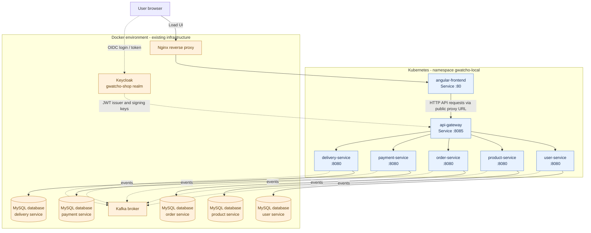

# Angular Frontend and Microservices Architecture

## Overview

The Angular frontend is deployed in the local Kubernetes cluster in namespace `gwatcho-local`. It communicates with backend APIs through the API Gateway. Keycloak, Kafka, Nginx, and MySQL are currently retained in the Docker environment; they are not moved by this frontend deployment.

## Architecture diagram

The diagram shows the intended logical connections. Solid arrows represent HTTP/API traffic; dashed arrows represent authentication or messaging/infrastructure connections. The exact host ports, database names, and Kafka topic names should be confirmed against the current Docker Compose and application configuration.



### Request and authentication flow

1. The browser loads the Angular application through the existing Nginx entry point.
2. Angular uses a browser-reachable API URL to call the API Gateway. Do not use Kubernetes-only DNS names directly in browser configuration.
3. The user signs in through Keycloak using the configured OIDC client and realm.
4. Angular sends the access token with protected API requests. The API Gateway validates the JWT using the configured issuer/JWK metadata.
5. The API Gateway routes requests to the appropriate backend service: user, product, order, payment, or delivery.
6. Each backend service connects to its own MySQL database in the Docker environment.
7. Services that publish or consume asynchronous events connect to the Docker-hosted Kafka broker according to their configured topics and producer/consumer setup.

## Network boundary: Kubernetes and Docker

Because the application services run in Kubernetes while MySQL, Keycloak, and Kafka remain in Docker, verify that each Kubernetes workload can reach the correct host address and published port. A hostname that works inside a Docker container or on the Windows host may not resolve the same way from a Kubernetes pod.

For each connection, verify:

- The Docker service publishes the required port on a host interface reachable from Kubernetes.
- The Kubernetes application configuration uses the correct reachable hostname and port.
- Firewalls and bind addresses permit the connection.
- Keycloak's configured JWT `iss` value exactly matches the issuer expected by the API Gateway. Changing the URL without aligning the issuer can cause JWT validation failures.
- Kafka's advertised listeners return an address reachable by Kubernetes clients; a reachable bootstrap port alone is not always sufficient.
- MySQL database/schema names and credentials match the corresponding service configuration or Vault-injected secret.

The diagram intentionally labels database nodes by service rather than assuming unverified schema names. Confirm exact database names, ports, Kafka topics, and actual network routes from the current Docker Compose files and service configuration.

## Angular frontend Kubernetes manifests

The frontend manifests are maintained at:

```text
kubernetes/base/angular-frontend/
├── deployment.yaml
├── kustomization.yaml
└── service.yaml
```

The current Deployment uses `ghcr.io/guybami/gwatcho-angular-frontend:develop-latest`, the existing `ghcr-pull-secret`, one replica, and an internal ClusterIP Service on port 80.

## Apply the manifests

Run from the local `gwatcho-infrastructure` repository in PowerShell:

```powershell
kubectl kustomize .\kubernetes\base\angular-frontend
kubectl apply -k .\kubernetes\base\angular-frontend
kubectl rollout status deployment/angular-frontend -n gwatcho-local --timeout=180s
```

## Verify the deployment

```powershell
kubectl get deployments,pods,services -n gwatcho-local |
  Select-String "angular-frontend"
```

Expected healthy state:

- Deployment: `1/1` available
- Pod: `1/1 Running`
- Service: `ClusterIP`, port `80/TCP`

## Test the frontend locally

Start port forwarding in one PowerShell terminal and leave it running:

```powershell
kubectl port-forward -n gwatcho-local svc/angular-frontend 4201:80
```

In a second terminal:

```powershell
Invoke-WebRequest -Uri "http://localhost:4201/" -UseBasicParsing |
  Select-Object StatusCode, StatusDescription
```

Or open `http://localhost:4201/` in a browser. A successful HTTP response confirms that the frontend is serving its page; also check the browser UI and developer console for application, API, and login errors.

## Inspect the deployed image

```powershell
kubectl get deployment angular-frontend -n gwatcho-local -o jsonpath='{.spec.template.spec.containers[0].image}'
```

## Operational notes

- The manifest assumes the frontend container serves HTTP on port 80. If the image uses another port, update the Deployment and Service consistently.
- A healthy Pod does not prove that API routing, database access, Kafka messaging, or Keycloak login works end to end.
- This documentation does not change Nginx, Keycloak, Kafka, backend services, or database volumes.
