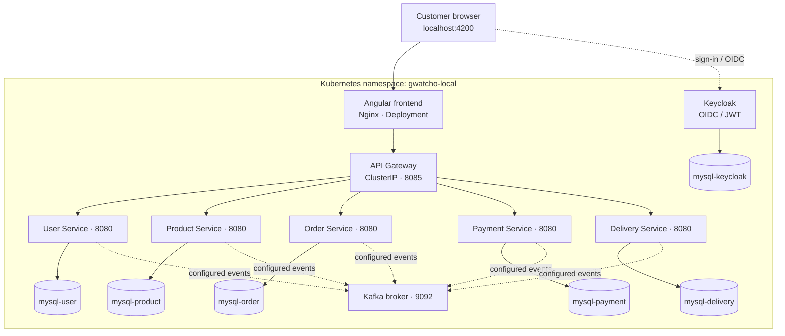

# Local Kubernetes Deployment — v1.1.0

## Status

**Milestone:** Local Kubernetes deployment  
**Environment:** Docker Desktop Kubernetes (local demo)  
**Namespace:** `gwatcho-local`  
**Target release:** `v1.1.0`  
**Validation snapshot:** 9 November 2026

The GWatcho Webshop stack is deployed in the local Docker Desktop Kubernetes cluster. The supplied cluster inventory showed all application Deployments at `1/1` available and their corresponding application Pods in `Running` state. The Angular Products page was also opened successfully at `http://localhost:4200/products` and displayed 300 products for the authenticated customer.

This is a local demo milestone, not a claim of production readiness.

## Deployed workloads

| Component | Kubernetes workload | Service port |
|---|---|---:|
| Angular frontend (Nginx static web server) | `angular-frontend` Deployment | 80 |
| API Gateway | `api-gateway` Deployment | 8085 |
| User Service | `user-service` Deployment | 8080 |
| Product Service | `product-service` Deployment | 8080 |
| Order Service | `order-service` Deployment | 8080 |
| Payment Service | `payment-service` Deployment | 8080 |
| Delivery Service | `delivery-service` Deployment | 8080 |
| Keycloak | `keycloak` Deployment | 8080 |
| Kafka | `kafka` StatefulSet / broker service | 9092 |
| User database | `mysql-user` Deployment | 3306 |
| Product database | `mysql-product` Deployment | 3306 |
| Order database | `mysql-order` Deployment | 3306 |
| Payment database | `mysql-payment` Deployment | 3306 |
| Delivery database | `mysql-delivery` Deployment | 3306 |
| Keycloak database | `mysql-keycloak` Deployment | 3306 |

All resources are scoped to the `gwatcho-local` namespace. Service names are used for in-cluster communication.

## Request and identity flow

1. The browser accesses the Angular application through the local frontend endpoint.
2. Nginx serves the Angular static application and reverse-proxies API paths to the in-cluster `api-gateway:8085` service.
3. The API Gateway routes requests to the relevant backend ClusterIP service.
4. Keycloak provides OpenID Connect authentication; the frontend sends access tokens and the Gateway/backend security configuration validates JWTs.
5. Each backend service persists its domain data in its corresponding MySQL database.
6. Kafka provides asynchronous messaging between services where event-driven workflows are configured.

## Architecture diagram



The dotted Kafka links indicate event-driven integration paths in the application architecture; they do not specify topic names, exact producer/consumer ownership, or event schemas. Those contracts must be verified in the individual service repositories.

## Frontend and API routing

For local Angular development, the development proxy forwards frontend paths to the locally forwarded API Gateway. In the Kubernetes frontend container, Nginx reverse-proxies API paths to the Kubernetes API Gateway service.

Representative in-cluster routes:

| Browser-facing path | Gateway route prefix | Backend service |
|---|---|---|
| `/api/products` | `/api-gateway/product-service/api/` | `product-service:8080` |
| `/api/users` | `/api-gateway/user-service/api/users/` | `user-service:8080` |
| `/api/order-service/` | `/api-gateway/order-service/` | `order-service:8080` |
| `/api/delivery-service/` | `/api-gateway/delivery-service/` | `delivery-service:8080` |

The exact route predicates and rewrite behavior are defined by the deployed Gateway and Nginx configurations. Confirm them against the current manifests before changing routes.

## Operational verification

Run from PowerShell with the Docker Desktop Kubernetes context selected:

```powershell
kubectl config current-context
kubectl get nodes -o wide
kubectl get deployments -n gwatcho-local
kubectl get pods -n gwatcho-local -o wide
kubectl get services -n gwatcho-local
kubectl get events -n gwatcho-local --sort-by=.metadata.creationTimestamp
```

Wait for a specific rollout:

```powershell
kubectl rollout status deployment/angular-frontend -n gwatcho-local --timeout=180s
kubectl rollout status deployment/api-gateway -n gwatcho-local --timeout=180s
```

Inspect the deployed frontend image and digest:

```powershell
kubectl get pods -n gwatcho-local -l app=angular-frontend `
  -o jsonpath="{range .items[*]}{.metadata.name}{'\n'}{range .status.containerStatuses[*]}Image: {.image}{'\n'}ImageID: {.imageID}{'\n'}{end}{end}"
```

The validation snapshot showed 14 Deployments: Angular frontend, API Gateway, five backend services, Keycloak, and six MySQL instances. It also showed Kafka running as a StatefulSet. The Angular Products page displayed 300 products. Pod restart counts were present in the snapshot; a Pod in `Running` state is not, by itself, proof that its historical restarts were harmless. Review events and previous container logs when diagnosing restarts.

## CI/CD and image provenance

Application repositories build and publish their own container images to GitHub Container Registry (GHCR). The Angular frontend workflow uses GitHub Actions and a Windows self-hosted runner to update the local Kubernetes Deployment.

For release deployments, prefer an immutable commit-SHA image tag or digest rather than a mutable branch tag such as `develop-latest`. The exact deployed image can be checked with the commands above.

Do not commit kubeconfig files, access tokens, decoded Kubernetes Secret values, passwords, or private keys. Keep the GHCR pull secret in the Kubernetes namespace and grant the deployment identity only the permissions it needs.

## Troubleshooting and safe rollback

- **ImagePullBackOff / ErrImagePull:** inspect Pod events and verify that the Docker Desktop Kubernetes node can reach the image registry. Windows host connectivity alone does not prove node-level registry connectivity.
- **Pod not Ready:** inspect readiness/liveness probe events and application logs.
- **Gateway 5xx:** inspect Gateway logs and verify the Kubernetes DNS name, port, context path, and route rewrite for the target service.
- **Database connection errors:** verify the service-specific MySQL Service, credentials Secret reference, database name, and JDBC URL. Do not print Secret values.
- **Kafka connection errors:** verify the Kafka Service, listener/advertised listener configuration, bootstrap address, and consumer logs.

Use a Deployment rollback only after checking its revision and the previous image:

```powershell
kubectl rollout history deployment/angular-frontend -n gwatcho-local
kubectl rollout undo deployment/angular-frontend -n gwatcho-local
kubectl rollout status deployment/angular-frontend -n gwatcho-local --timeout=180s
```

A Kubernetes Deployment rollback does not roll back database schemas or persisted data. Do not delete database volumes as an application troubleshooting step.

## Release history and next milestone

- `v1.0.0`: Docker-based deployment baseline.
- `v1.1.0`: Local Docker Desktop Kubernetes deployment documentation and architecture baseline.
- Next planned milestone: Azure Kubernetes Service (AKS) deployment.

The local Docker Desktop cluster is a demo/development environment. Before production exposure, design and validate managed hosting, TLS/DNS, backups and restore, monitoring/alerting, resource limits, network policies, secrets management, vulnerability scanning, and disaster recovery.
