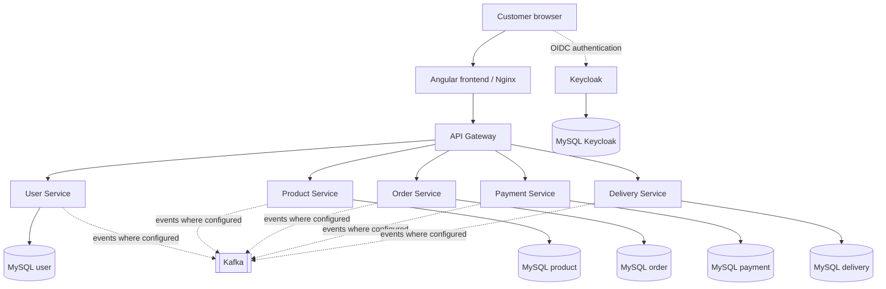

# GWatcho Webshop — Final Application Architecture

## Architecture summary

GWatcho Webshop is a containerized e-commerce demonstration application built from an Angular frontend and Spring Boot microservices. The local integrated deployment is orchestrated by Docker Desktop Kubernetes in namespace `gwatcho-local`.

The platform includes a central API Gateway, Keycloak for OpenID Connect authentication and JWT-based API security, Kafka for asynchronous messaging, and separate MySQL instances for the application domains and Keycloak.

## Component view

| Layer | Component | Responsibility |
|---|---|---|
| Presentation | Angular frontend served by Nginx | Customer-facing shop UI and API reverse proxy |
| Edge/API | Spring Cloud API Gateway | Central backend routing and security boundary |
| Identity | Keycloak | OIDC login, token issuance and realm/client configuration |
| Domain | User Service | Customer profile and user-related operations |
| Domain | Product Service | Product catalog and inventory operations |
| Domain | Order Service | Checkout and order lifecycle |
| Domain | Payment Service | Payment processing/status workflow |
| Domain | Delivery Service | Delivery and shipment lifecycle |
| Messaging | Apache Kafka | Asynchronous service-to-service events |
| Persistence | MySQL user/product/order/payment/delivery | Service-specific relational persistence |
| Identity persistence | MySQL Keycloak | Keycloak relational persistence |
| Orchestration | Docker Desktop Kubernetes | Deployments, Services, StatefulSet and namespace isolation |
| Delivery | GitHub Actions + GHCR | Build, test, image publication and deployment automation |

## Kubernetes deployment topology

The integrated local deployment runs in namespace `gwatcho-local`.

- Angular frontend: Deployment, container port 80, exposed locally through the frontend endpoint.
- API Gateway: Deployment, Service port 8085.
- Five Spring Boot domain services: individual Deployments and ClusterIP Services on port 8080.
- Keycloak: Deployment and Service on port 8080.
- Kafka: broker StatefulSet and Service on port 9092.
- Six MySQL workloads: five application databases plus the Keycloak database, each exposed through an in-cluster Service on port 3306.

The frontend Nginx configuration forwards API requests to `http://api-gateway:8085`. The Gateway then routes to backend Kubernetes Service DNS names. The exact URL prefixes and path rewrites are owned by the active Nginx and Gateway configurations.

## Logical architecture

Kafka arrows are conceptual event-driven integration paths. Topic names, event payloads, consumer groups, and exact producer/consumer relationships must be verified in the corresponding application repositories before treating them as interface contracts.

## Request and authentication flow

1. The customer opens the Angular application.
2. Angular uses Keycloak through OpenID Connect for authentication.
3. The browser sends API requests with the access token.
4. Nginx forwards API paths to the API Gateway.
5. The Gateway routes the request to the appropriate domain Service.
6. The backend service validates the token according to its resource-server configuration and executes the domain operation.
7. The service persists its own domain data in its MySQL database.
8. Configured asynchronous workflows publish or consume Kafka events.

## Local Kubernetes validation baseline

The recorded local cluster inventory showed the frontend, API Gateway, five domain services, Keycloak, and six MySQL Deployments in namespace `gwatcho-local`, plus a Kafka StatefulSet. The supplied Angular browser screenshot showed the authenticated Products page at `http://localhost:4200/products` with 300 products displayed.

This is evidence of a working local demo path for authentication and product browsing. It does not by itself certify every checkout, payment, delivery, failure-recovery, load, security, or disaster-recovery scenario.

See [Local Kubernetes Deployment — v1.1.0](../kubernetes/local-kubernetes-deployment.md) for workload inventory, verification commands, image provenance, and troubleshooting.

## Repository and deployment responsibilities

- Application repositories own their service source code, tests, Dockerfiles, and application CI workflows.
- `gwatcho-infrastructure` owns local orchestration, Kubernetes manifests, deployment documentation, and infrastructure-level configuration.
- GitHub Actions builds and publishes application images to GHCR. The local Kubernetes deployment is updated by the configured self-hosted runner.
- Release deployments should use immutable image tags or digests and should not rely on mutable branch tags.

## Production-readiness boundary

The Docker Desktop Kubernetes cluster is a local development/demo environment, not a highly available production platform. The planned next deployment milestone is AKS. Production design must additionally address TLS and DNS, managed ingress, high availability, resource sizing, network policies, secret lifecycle, persistent storage, backups and restore drills, observability, vulnerability scanning, access control, and disaster recovery.
